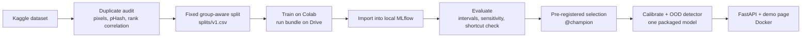

# NeuroScan

[](https://github.com/AminRezaeeyan/NeuroScan/actions/workflows/ci.yml)


Brain tumor classification from 2D MRI slices (glioma, meningioma, pituitary tumor, no
tumor), built to produce numbers that hold up to scrutiny: a duplicate-aware evaluation,
tracked experiments, a model chosen by a rule fixed in advance, calibrated probabilities,
and a service that refuses inputs it wasn't built for.

> **Research demo, not a medical device.** NeuroScan must not be used for diagnosis or
> any decision about a patient.

> **Project history.** The foundation of NeuroScan (the CNN architecture, its training
> recipe and the first web app) was built in February–March 2025 and released as
> [v1.0.0](https://github.com/AminRezaeeyan/NeuroScan/releases/tag/v1.0.0) (2 March 2025)
> and [v1.1.0](https://github.com/AminRezaeeyan/NeuroScan/releases/tag/v1.1.0)
> (23 March 2025). In October 2026, about a year and a half later, I revisited it and
> re-engineered it into the system described here: an audited dataset and leakage-free
> evaluation, tracked experiments, a pre-registered model comparison, calibration,
> out-of-distribution refusal, a secured API and tests with CI. The original model is kept
> as a reference and [re-evaluated below](#the-original-model-measured-honestly); its code
> remains available under the v1 tags.


## Highlights

- **An honest test set.** 55% of the dataset's own test images have a near-duplicate in
  its training images. NeuroScan detects duplicates (including contrast-altered copies)
  and builds a split where no duplicate group crosses train, validation and test.
  The original model's 98.3% becomes 88.0% on test images it hasn't effectively seen.
- **Four models, one pre-registered rule.** A baseline CNN, a lighter variant,
  EfficientNetB0 and ResNet50, trained on Colab, tracked in MLflow and compared with 95%
  confidence intervals. The champion was chosen on validation data by a rule committed
  before training.
- **Calibrated, and able to say no.** Temperature scaling halves calibration error. A
  Mahalanobis detector refuses photos, X-rays, CT and spine MRI (AUROC 0.998), and
  low-confidence cases are sent to review: the answered 89% of test scans are 98.8%
  accurate.
- **Measured shortcuts.** File and acquisition properties alone predict the class 79% of
  the time. Every evaluation reports how much each model leans on such cues.
- **Served safely.** FastAPI service and a single-page demo, loaded from the MLflow
  registry by alias, with in-memory uploads, strict security headers and a hardened,
  read-only Docker container.

## Results

All four models were trained with the same split, seed and augmentation, and are
evaluated on the same 1,050 held-out test images, with **each group of near-duplicates
counted once**.

| Model | Params | Test macro F1 (95% CI) | Tumor sensitivity | Shortcut gap | CPU latency |
| --- | ---: | --- | ---: | ---: | ---: |
| Baseline CNN (original architecture) | 9.7M | 0.954 (0.933–0.972) | 99.0% | +10.9 pt | 12.5 ms |
| CNN + global average pooling | 0.26M | 0.879 (0.847–0.906) | 97.3% | +22.6 pt | 10.0 ms |
| **EfficientNetB0 (champion)** | 4.1M | 0.955 (0.936–0.972) | 99.0% | +10.5 pt | 30.1 ms |
| ResNet50 | 23.6M | 0.967 (0.952–0.981) | 99.8% | +4.5 pt | 90.7 ms |

*Shortcut gap: how much more accurate a model is on images whose class can be guessed
from metadata alone. Smaller is better.*

- EfficientNetB0, ResNet50 and the baseline are statistically tied (overlapping
  intervals). The [selection rule](docs/model_selection.md) then keeps tumor sensitivity
  within 1 point and prefers the faster model: EfficientNetB0 is 3x faster and 6x smaller
  than ResNet50.
- With the refusal rules on, the served model refuses 2.2% of real test MRIs as out of
  distribution, sends 8.7% to review as uncertain, and answers the rest with **98.8%
  accuracy**.


| Refusing inputs | Refused | AUROC, Mahalanobis / max softmax |
| --- | ---: | --- |
| Natural photos | 100% | 1.000 / 0.965 |
| Chest X-ray | 100% | 1.000 / 0.961 |
| Lumbar spine MRI | 100% | 0.999 / 0.866 |
| CT slices | 94.3% | 0.994 / 0.947 |

More: [results](docs/results.md) (all tables and figures, generated from MLflow),
[data audit](docs/data_audit.md), [model card](docs/model_card.md),
[performance](docs/performance.md).

### The original model, measured honestly

| Evaluation set | Accuracy (95% CI) | Macro F1 |
| --- | --- | --- |
| Published claim (earlier dataset version) | 98.3% | |
| Kaggle `Testing`, current version | 94.1% (92.9–95.2) | 0.939 |
| Kaggle `Testing` images with no duplicate in `Training` | **88.0% (85.3–90.5)** | **0.801** |

## How it works



For each uploaded image the service returns one of four statuses:

| Status | When |
| --- | --- |
| `ok` | In distribution and confident: class + calibrated probabilities + Grad-CAM |
| `uncertain` | In distribution, calibrated confidence below 0.86: sent to review |
| `rejected_ood` | Features far from every training class (Mahalanobis distance) |
| `rejected_input` | Not a plausible MRI file: undecodable, odd size, or a color image |

Every decision and its alternatives are explained in **[docs/design.md](docs/design.md)**.

## Quick start

The trained model is not stored in git: it lives in a local MLflow registry. Running the
demo therefore needs the registry, which [docs/reproducing.md](docs/reproducing.md)
builds from scratch (training takes about four Colab sessions).

```bash
make install            # Python 3.12 + uv; installs everything and the git hooks
make data               # download the dataset (Kaggle token in ~/.kaggle/access_token)
make mlflow             # browse experiments on http://127.0.0.1:5000
make serve              # API + demo page on http://127.0.0.1:8000 (needs @champion)
make docker-up          # same, in a hardened container
```

### API

```bash
curl -F "file=@scan.jpg" http://127.0.0.1:8000/v1/predict
```

```json
{
  "model_version": "7",
  "status": "ok",
  "prediction": "meningioma",
  "confidence": 0.998,
  "probabilities": {"glioma": 0.001, "meningioma": 0.998, "notumor": 0.0, "pituitary": 0.001},
  "calibrated": true,
  "ood_score": 2093.1,
  "ood_threshold": 3918.3,
  "latency_ms": 74.2,
  "input_png_base64": "…",
  "heatmap_png_base64": "…",
  "disclaimer": "Research demo, not a medical device. Do not use for diagnosis."
}
```

| Endpoint | |
| --- | --- |
| `POST /v1/predict` | One image (`?heatmap=false` skips Grad-CAM) |
| `POST /v1/predict/batch` | Up to 16 images |
| `GET /v1/info` | Served model version, thresholds, headline metrics |
| `GET /health`, `GET /ready` | Liveness and readiness |
| `GET /metrics` | Prometheus metrics |
| `GET /docs` | Interactive API documentation |

Errors return `{"error": "<code>"}`: `not_an_image` / `bad_size` (400), `file_too_large`
(413), `model_not_loaded` (503).

## Repository layout

```text
src/neuroscan/
  config.py            YAML configs -> dataclasses
  data/                download, duplicate audit, splits, preprocessing, metadata probe
  models/              one builder per model
  train.py             config-driven training -> run bundle (resumable)
  evaluate.py          metrics, cluster-bootstrap intervals, shortcut check
  calibrate.py         temperature scaling
  explain.py           Grad-CAM + brain-mask check
  ood.py               Mahalanobis detector and thresholds
  optimize.py          TFLite export and benchmark
  tracking/            run-bundle import, legacy model, model selection
  serving/             FastAPI app, demo page, input checks, packaged model, monitoring
  reports/             figures and dashboards
configs/               one YAML per model
splits/v1.csv          the fixed split (committed)
notebooks/             data exploration, Colab training notebook
tests/                 unit, integration, API and behavioral tests
docs/                  design, data audit, model card, results, performance, reproducing
```

## Testing and CI

```bash
make ci                 # ruff, mypy, bandit, pytest (84 tests)
make test-behavioral    # 8 tests against the real champion (needs the local registry)
```

GitHub Actions runs lint, type checks, the security scan, a notebook-output check and the
test suite on every pull request, and builds the Docker image. Tests cover duplicate
detection, split integrity, train/serve parity, training resume, MLflow import,
calibration, OOD rejection, and API security cases (renamed text files, oversized
uploads, path-traversal file names, security headers).

## Limitations

- **Image-level evaluation on one public dataset.** The dataset has no patient IDs, so
  different slices of one patient can sit in different splits. Performance on other
  scanners or hospitals is unknown.
- **Source shortcuts.** Image source partly reveals the class (a metadata-only probe
  reaches 79%), and every model leans on it to some degree. Tumor-versus-no-tumor
  results in particular are likely optimistic.
- **"Out of distribution" means unlike the training data**, not "not a brain MRI".
  Real brain MRIs framed differently can be refused, and some CT slices are accepted.
- **2D slices only**, four classes, and some label noise between glioma and meningioma.
- **Grad-CAM** shows where the model looked, not why.

Planned: reduce the source shortcut with head cropping and per-image intensity
normalization, then retrain and compare ([design.md](docs/design.md#17-open-problems-and-next-steps)).

## Data and license

Dataset: [Brain Tumor MRI Dataset](https://www.kaggle.com/datasets/masoudnickparvar/brain-tumor-mri-dataset)
by Masoud Nickparvar (CC BY 4.0). The five demo images in
`src/neuroscan/serving/static/samples/` come from its held-out test split.

Code: MIT License, see [LICENSE](LICENSE). Author: Amin Rezaeeyan.
