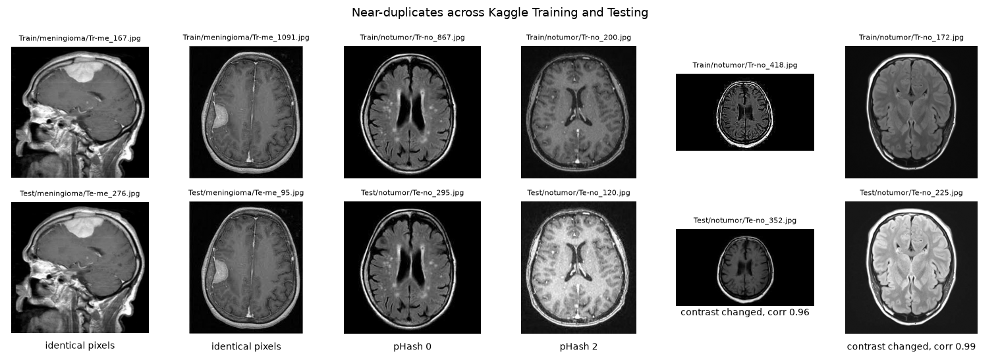

# Data audit

What the [Brain Tumor MRI Dataset](https://www.kaggle.com/datasets/masoudnickparvar/brain-tumor-mri-dataset)
contains, what is wrong with it for honest evaluation, and how NeuroScan handles each
problem. Reproduce with `make data`, the exploration notebook
(`notebooks/01_data_exploration.ipynb`), `make dedup` and `make split`.

## The dataset

| | Glioma | Meningioma | No tumor | Pituitary | Total |
| --- | ---: | ---: | ---: | ---: | ---: |
| Kaggle `Training` | 1,400 | 1,400 | 1,400 | 1,400 | 5,600 |
| Kaggle `Testing` | 400 | 400 | 400 | 400 | 1,600 |

7,200 2D MRI slices in axial, coronal and sagittal views, with no view label and no
patient ID. The dataset merges several public collections. An earlier version had 7,023
images; all NeuroScan results use the current one.

## Finding 1: the label is partly visible in how an image was produced

| | Tumor classes | No tumor |
| --- | --- | --- |
| Typical size | 512x512 (86–96% of each class) | mostly small, median 228x243, wide spread |
| Format | mostly JPEG | many PNG |
| Pixels | darker, framed with black background | brighter, higher contrast, often no background |
| Color images | none | 3.7% |

"No tumor" images largely come from a different source than the tumor classes, and the
tumor classes also differ in framing and brightness (the mean image per class shows it).

**Measured:** a random forest that sees only metadata (width, height, aspect ratio, file
size, format, mean intensity, contrast, background share, color spread), no anatomy,
predicts the class with **79.4% ± 1.3% accuracy** (5-fold CV, chance 25%) and recognizes
"no tumor" at about **99% recall**.

**Why it matters:** a CNN can learn the same cues. A high "no tumor" recall is weak
evidence of understanding anatomy, and tumor-versus-no-tumor numbers are likely
optimistic.

**Handling:**

- Every evaluation reports a **shortcut check**: the model's accuracy on test images the
  metadata probe gets right versus wrong. Results per model: 4.5 to 22.6 points
  (champion: 10.5).
- Resizing to 224x224 hides resolution and format from the model, but not brightness,
  contrast, framing or the blur of upscaled small images.
- Planned: crop to the head and normalize intensity per image, then retrain and measure
  whether the gap shrinks ([design.md](design.md#17-open-problems-and-next-steps)).

## Finding 2: Kaggle's Testing folder overlaps its Training folder

Exact byte-level duplicates are only the tip: 340 files in 153 groups, all within one
folder. Near-duplicates are the real problem.

**Method** (`neuroscan.data.dedup`): two images are linked if they have identical pixels,
a perceptual-hash distance of at most 4, or a rank correlation of at least 0.96 between
their 64x64 grayscale versions. Rank correlation compares the order of pixel intensities,
so it matches contrast-altered copies that perceptual hashes miss. Links are merged into
groups. Thresholds were set by inspecting example pairs at each level, before the split
was built.

| | |
| --- | ---: |
| Images in a duplicate group | 4,333 of 7,200 (60%) |
| Duplicate groups | 1,162 (largest: 61 images) |
| **Kaggle `Testing` images with a near-duplicate in `Training`** | **883 of 1,600 (55%)** |
| ...of which "no tumor" | 377 of 400 |
| Groups with conflicting labels | 27 (mostly glioma versus meningioma) |

**Why it matters:** a model evaluated on the Kaggle `Testing` folder is partly tested on
images it has seen. The original model scored 94.1% on the full folder but 88.0% on the
641 test images with no duplicate in `Training` (macro F1 0.778 with groups counted once).

## Finding 3: pre-augmented copies

203 meningioma files named `*-aug-*` are flipped, rotated or zoomed copies of other
images. Geometric transforms defeat pixel-based matching, so they could leak across
splits undetected. They are **excluded**.

## Finding 4: label noise

Of the 27 groups with conflicting labels, most pair the same image (or a near-copy) as
glioma and as meningioma. These are kept as-is: there is no ground truth to correct them
with, and dropping them would hide the problem. They put a ceiling on achievable accuracy
between those two classes, which are also the model's most frequent confusion.

## The split used everywhere: `splits/v1.csv`

- The Kaggle `Training`/`Testing` folders are ignored.
- 70/15/15 train/validation/test with `StratifiedGroupKFold` (seed 42): balanced classes,
  and **every duplicate group in exactly one split**.
- Near-duplicates stay in the data (many are distinct adjacent slices); grouping is what
  prevents leakage. Within the test split, metrics are also reported with each group
  counted once, with cluster-bootstrap intervals.

| Split | Glioma | Meningioma | No tumor | Pituitary | Total |
| --- | ---: | ---: | ---: | ---: | ---: |
| train | 1,260 | 1,117 | 1,260 | 1,260 | 4,897 |
| validation | 270 | 240 | 270 | 270 | 1,050 |
| test | 270 | 240 | 270 | 270 | 1,050 |

6,997 images in 3,891 groups (meningioma is smaller because of the excluded augmented
files). The file is committed; its hash `0816b6f44c96` is stored in every training run,
and a test pins these counts.

## What this audit cannot fix

- **Patient leakage.** Without patient IDs, two different slices of the same patient that
  don't look alike end up in different splits. Results are image-level, not
  patient-level.
- **One source per class.** The source shortcut can be measured and reduced, but not
  removed without data from other sources.
