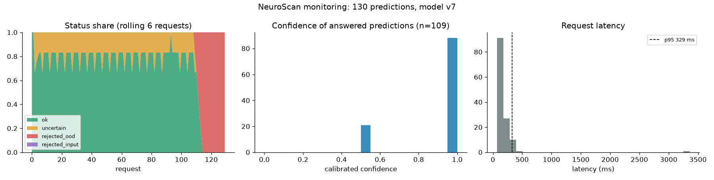

# Performance

All numbers on a laptop CPU (4 cores, no GPU), measured on the first champion
(EfficientNetB0, model v7). The current champion (v10) has the same architecture; its
head cropping and intensity normalization add preprocessing work per upload that is not
separately benchmarked here.

## Runtime and quantization (`python -m neuroscan.optimize --champion`)

Single-image CPU latency, and accuracy on the 1,050-image test split.

| Runtime | Size | CPU p50 | CPU p95 | Max prob. diff vs Keras | Same class as Keras | Test accuracy | Test macro F1 |
| --- | ---: | ---: | ---: | ---: | ---: | ---: | ---: |
| Keras | 16.2 MB | 18.0 ms | 21.1 ms | 0 | 100.0% | 96.0% | 0.959 |
| TFLite float32 | 16.1 MB | 15.5 ms | 17.5 ms | 4.8e-05 | 100.0% | 96.0% | 0.959 |
| TFLite INT8 weights | 4.6 MB | 16.5 ms | 17.4 ms | 0.26 | 98.9% | 95.8% | 0.957 |

- TFLite float32 is numerically the same model and ~15% faster.
- INT8 weights make the model 3.5x smaller for -0.2 points of accuracy, but not faster
  here: with dynamic-range quantization the weights are dequantized at run time.
- The API keeps Keras: Grad-CAM and the OOD detector need gradients and intermediate
  features, which the TFLite models don't expose.

## API load test (`python -m neuroscan.serving.loadtest`)

One uvicorn worker on the same laptop, uploads cycling through the demo images, 0 errors
in every run. "Before" ran the OOD feature extractor and Grad-CAM eagerly, layer by layer;
"after" runs them as compiled TensorFlow graphs.

| Requests in parallel | Grad-CAM | Before: req/s, p95 | After: req/s, p95 |
| ---: | --- | ---: | ---: |
| 1 | no | 3.8, 284 ms | **10.9, 111 ms** |
| 2 | no | 4.5, 489 ms | **19.4, 129 ms** |
| 4 | no | 4.3, 990 ms | **21.4, 218 ms** |
| 1 | yes | 1.1, 1146 ms | **7.3, 171 ms** |
| 4 | yes | 1.4, 2960 ms | **13.2, 353 ms** |

At about 20 requests/s the p95 latency stays near 0.2 s. More throughput would come from
more workers (`WORKERS`, ~0.5 GB of memory each) or batching requests.

## Monitoring

The API exposes `/metrics` (Prometheus format: predictions by status and class, latency
and confidence histograms) and, with `NEUROSCAN_PREDICTION_LOG` set, appends one JSON line
per prediction: status, class, calibrated confidence, OOD score, latency and model version,
never the image or file name. `python -m neuroscan.reports.monitoring <log>` turns the log
into the dashboard below (here: load-test traffic, not real usage).

