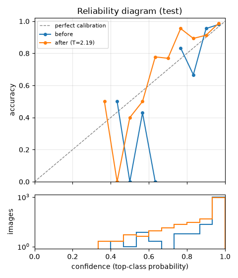
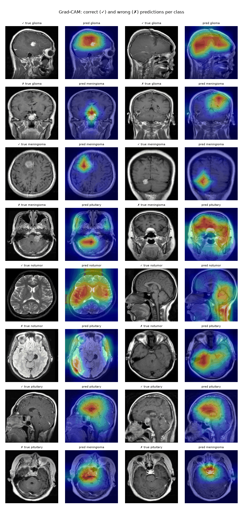
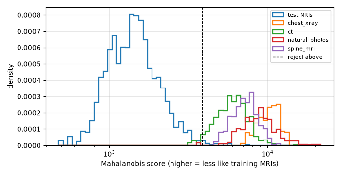

# Model comparison

Generated by `python -m neuroscan.reports.figures` from the tracked MLflow runs.
All four models use `splits/v1.csv`; metrics count each duplicate group once.

| Model | Params | Val macro F1 (95% CI) | Test macro F1 (95% CI) | Test accuracy | Tumor sensitivity | Tumor specificity | Shortcut gap | CPU latency |
| --- | ---: | --- | --- | ---: | ---: | ---: | ---: | ---: |
| baseline_cnn | 9.68M | 0.953 (0.933–0.971) | 0.954 (0.933–0.972) | 95.9% | 99.0% | 91.6% | +10.9 pt | 12.5 ms |
| resnet50 | 23.60M | 0.969 (0.954–0.983) | 0.967 (0.952–0.981) | 96.8% | 99.8% | 94.4% | +4.5 pt | 90.7 ms |
| efficientnet_b0+shortcut_reduced | 4.05M | 0.965 (0.948–0.979) | 0.960 (0.942–0.976) | 96.0% | 99.6% | 95.8% | +6.2 pt | 18.0 ms |
| efficientnet_b0 | 4.05M | 0.964 (0.947–0.979) | 0.955 (0.936–0.972) | 95.6% | 99.0% | 97.2% | +10.5 pt | 30.1 ms |
| cnn_gap | 0.26M | 0.853 (0.823–0.882) | 0.879 (0.847–0.906) | 88.3% | 97.3% | 90.2% | +22.6 pt | 10.0 ms |

## Selection ([rule](model_selection.md), validation metrics only)

1. Ranked by validation macro F1: resnet50 0.9690, efficientnet_b0+shortcut_reduced 0.9654, efficientnet_b0 0.9640, baseline_cnn 0.9528, cnn_gap 0.8529. Leader: resnet50.
2. 95% intervals overlapping the leader's (0.9537-0.9826): resnet50, efficientnet_b0+shortcut_reduced, efficientnet_b0, baseline_cnn.
3. Best tumor sensitivity in the tie 1.0000; kept within 1 point: resnet50, efficientnet_b0+shortcut_reduced, efficientnet_b0 (dropped baseline_cnn).
4. CPU latency p50: resnet50 90.7 ms, efficientnet_b0+shortcut_reduced 18.0 ms, efficientnet_b0 30.1 ms. Within 10% of the fastest: efficientnet_b0+shortcut_reduced; fewest parameters among them: efficientnet_b0+shortcut_reduced.

**Champion:** EfficientNetB0, shortcut-reduced. **Baseline:** Baseline CNN.

## Calibration (temperature fitted on validation)

| Model | Temperature | Test ECE before → after | Test NLL before → after |
| --- | ---: | ---: | ---: |
| EfficientNetB0, shortcut-reduced | 2.19 | 0.023 → 0.014 | 0.163 → 0.108 |
| ResNet50 | 2.41 | 0.019 → 0.014 | 0.123 → 0.090 |
| EfficientNetB0 | 2.02 | 0.024 → 0.011 | 0.138 → 0.111 |
| CNN + GAP | 1.33 | 0.025 → 0.041 | 0.281 → 0.281 |
| Baseline CNN | 2.39 | 0.031 → 0.023 | 0.178 → 0.138 |

The champion is served with its temperature applied.

## Where the champion looks (Grad-CAM, test split)

- Heatmap peak inside the brain mask: 99.5% (chance, i.e. mask area: 68.7%).
- Share of heatmap mass inside the brain mask: 89.3%.
- Peak inside the brain for wrong predictions: 96.9%.

A sanity check, not proof of correct reasoning: the mask is a simple intensity threshold.

## Refusing what the model shouldn't answer (test split)

- Real test MRIs rejected as out of distribution: 2.0% (threshold set so about 2% of validation MRIs are rejected).
- Flagged uncertain (calibrated confidence < 0.75): 3.6%; accuracy on the answered rest: 98.2%.

| OOD source | Rejected | AUROC (Mahalanobis / max softmax) | FPR at 95% TPR (Mahalanobis / max softmax) |
| --- | ---: | ---: | ---: |
| chest xray | 100.0% | 1.000 / 0.989 | 0.0% / 3.2% |
| ct | 98.3% | 0.996 / 0.969 | 0.0% / 22.3% |
| natural photos | 100.0% | 1.000 / 0.988 | 0.0% / 4.7% |
| spine mri | 100.0% | 0.999 / 0.969 | 0.0% / 21.0% |

